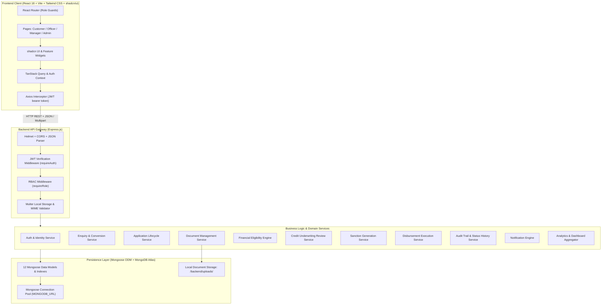

# LOANFLOW - System Architecture & Technical Specifications

This document defines the high-level and modular architecture of LOANFLOW, outlining the communication patterns, layer responsibilities, authentication security, and directory hierarchy.

---

## 1. System Architecture Overview



---

## 2. Security & Authentication Architecture

1. **Token Flow:**
   - Client authenticates with `POST /api/auth/login`.
   - Backend verifies password via `bcrypt.compare`.
   - On success, backend issues a signed JWT (`HS256`, 7-day expiration) containing `{ id, role, email, name }`.
   - Client stores token in `localStorage` and automatically attaches `Authorization: Bearer <token>` through Axios request interceptors.
2. **Session Verification (`GET /api/auth/me`):**
   - On initial page load / refresh, the React Auth Context dispatches `/api/auth/me` to hydrate user profile, role, and permissions.
   - If token is expired or tampered, it is cleanly evicted and user redirected to `/login`.
3. **Role Guards:**
   - **Backend:** `requireRole('LOAN_OFFICER', 'MANAGER', 'ADMIN')` validates the role encoded in the JWT session against allowed roles.
   - **Frontend:** `<ProtectedRoute allowedRoles={['CUSTOMER']} />` blocks unauthorized viewing and redirects appropriately.

---

## 3. Modular File Structure

### Frontend Structure (`frontend/`)
```
frontend/
├── index.html
├── package.json
├── vite.config.js
├── tailwind.config.js
├── postcss.config.js
└── src/
    ├── main.jsx
    ├── App.jsx
    ├── index.css
    ├── api/
    │   ├── axiosClient.js
    │   ├── authApi.js
    │   ├── applicationApi.js
    │   ├── documentApi.js
    │   ├── enquiryApi.js
    │   └── dashboardApi.js
    ├── context/
    │   ├── AuthContext.jsx
    │   └── NotificationContext.jsx
    ├── components/
    │   ├── ui/ (Button, Card, Badge, Dialog, Tabs, Table, etc.)
    │   ├── common/ (Navbar, Sidebar, PageHeader, StatusBadge, EmptyState)
    │   ├── applications/ (ApplicationTracker, ApplicationDetails, DocumentUploadModal)
    │   └── dashboard/ (MetricCard, PipelineChart, RecentApplicationsTable)
    ├── layouts/
    │   ├── DashboardLayout.jsx
    │   └── AuthLayout.jsx
    ├── pages/
    │   ├── auth/ (Login, Register)
    │   ├── customer/ (CustomerDashboard, MyApplications, ApplyLoan, ApplicationView)
    │   ├── officer/ (OfficerDashboard, EnquiriesView, ApplicationsReview, ApplicationDossier)
    │   ├── manager/ (ManagerDashboard, ApprovalQueue, DisbursementQueue)
    │   └── admin/ (AdminDashboard, ProductManagement, UserManagement, SystemAudit)
    └── utils/ (formatters, constants, calculations)
```

### Backend Structure (`backend/`)
```
backend/
├── package.json
├── .env.example
├── server.js
├── src/
│   ├── app.js
│   ├── config/
│   │   └── db.js
│   ├── models/
│   │   ├── User.js
│   │   ├── Customer.js
│   │   ├── LoanProduct.js
│   │   ├── LoanEnquiry.js
│   │   ├── LoanApplication.js
│   │   ├── ApplicationDocument.js
│   │   ├── EligibilityAssessment.js
│   │   ├── ApplicationReview.js
│   │   ├── Sanction.js
│   │   ├── Disbursement.js
│   │   ├── ApplicationStatusHistory.js
│   │   └── Notification.js
│   ├── middleware/
│   │   ├── authMiddleware.js
│   │   ├── errorMiddleware.js
│   │   └── uploadMiddleware.js
│   ├── controllers/
│   │   ├── authController.js
│   │   ├── enquiryController.js
│   │   ├── productController.js
│   │   ├── applicationController.js
│   │   ├── documentController.js
│   │   ├── eligibilityController.js
│   │   ├── reviewController.js
│   │   ├── approvalController.js
│   │   ├── sanctionController.js
│   │   ├── disbursementController.js
│   │   ├── historyController.js
│   │   ├── notificationController.js
│   │   └── dashboardController.js
│   ├── services/
│   │   ├── eligibilityEngine.js
│   │   ├── auditService.js
│   │   └── notificationService.js
│   ├── validators/ (schemas & input sanitization)
│   ├── utils/ (generators, responseFormatter, logger)
│   └── seed/
│       └── seedData.js
└── uploads/
    └── documents/
```

---

## 4. API Response Contract

All backend endpoints strictly adhere to the standard envelope schema:

### Success Response:
```json
{
  "success": true,
  "message": "Operation completed successfully",
  "data": { ... }
}
```

### Error Response:
```json
{
  "success": false,
  "message": "Human readable summary of the failure",
  "errors": [
    { "field": "requestedAmount", "message": "Amount must be between 50000 and 1500000" }
  ]
}
```
