# LOANFLOW - Business Workflow Specification

This document details the complete end-to-end operational lifecycle of loan applications within the LOANFLOW system, including normal happy-paths, exception handling, and role interactions.

---

## 1. End-to-End Workflow Diagram

```mermaid
flowchart TD
    %% Roles styling
    classDef customer fill:#eff6ff,stroke:#2563eb,stroke-width:2px;
    classDef officer fill:#fef3c7,stroke:#f59e0b,stroke-width:2px;
    classDef manager fill:#ede9fe,stroke:#7c3aed,stroke-width:2px;
    classDef system fill:#ecfdf5,stroke:#10b981,stroke-width:2px;
    classDef rejected fill:#fef2f2,stroke:#ef4444,stroke-width:2px;

    subgraph Phase1["1. Customer Intake & Qualification"]
        ENQ_START(["Customer Submits Enquiry"]):::customer
        ENQ_LOGGED["Status: NEW\nCode: ENQ-2026-XXXX"]:::system
        ENQ_CONTACT["Officer Contacts Lead\nStatus: CONTACTED"]:::officer
        ENQ_CONVERT{"Convert to Application?"}:::officer
        ENQ_CLOSE(["Enquiry Closed/Dropped"]):::rejected
    end

    subgraph Phase2["2. Application Origination"]
        APP_INIT["Create Loan Record\nStatus: APPLICATION_CREATED\nCode: LOAN-2026-XXXX"]:::system
        DOC_PENDING["Status: DOCUMENT_PENDING\nChecklist Generated"]:::system
        DOC_UPLOAD["Customer Uploads Mandatory Proofs"]:::customer
    end

    subgraph Phase3["3. Document Review & Verification"]
        DOC_REVIEW["Officer Inspects Files\nStatus: DOCUMENT_VERIFICATION"]:::officer
        DOC_CHECK{"All Proofs Valid?"}:::officer
        DOC_REJECT["Mark File REJECTED\nProvide Actionable Reason\nStatus: ADDITIONAL_DOCUMENTS_REQUIRED"]:::rejected
        DOC_REUPLOAD["Customer Re-uploads Rejected Proof"]:::customer
        DOCS_VERIFIED["All Required Documents VERIFIED"]:::system
    end

    subgraph Phase4["4. Underwriting & Eligibility"]
        ELIG_RUN["Run Quantitative Engine\nStatus: ELIGIBILITY_CHECK\nEMI, Obligations & DTI"]:::system
        ELIG_DECISION{"Meets DTI & Policy Limits?"}:::system
        ELIG_FAIL["Eligibility Assessment: NOT_ELIGIBLE"]:::rejected
        ELIG_PASS["Eligibility Assessment: ELIGIBLE"]:::system
        OFFICER_REVIEW["Officer Underwriting Dossier\nStatus: OFFICER_REVIEW"]:::officer
        OFFICER_DECISION{"Officer Recommendation"}:::officer
        OFFICER_REJECT["Recommend Rejection\nwith detailed rationale"]:::rejected
        OFFICER_RECOMMEND["Recommend Approval\nForward to Credit Committee"]:::officer
    end

    subgraph Phase5["5. Credit Manager Sanction & Decision"]
        MGR_QUEUE["Application Placed in Manager Queue\nStatus: MANAGER_APPROVAL"]:::system
        MGR_DECISION{"Manager Assessment"}:::manager
        MGR_REJECT["Manager Rejects Application\nStatus: REJECTED"]:::rejected
        MGR_APPROVE["Manager Approves\nSets Sanctioned Amount & Tenure\nStatus: APPROVED"]:::manager
        SANCTION_GEN["Issue Sanction Offer\nCode: SANC-2026-XXXX\nStatus: SANCTIONED"]:::system
    end

    subgraph Phase6["6. Disbursement & Servicing"]
        DISB_QUEUE["Status: DISBURSEMENT_PENDING"]:::system
        DISB_EXEC["Process Transfer\nCapture UTR / Ref No.\nAmount <= Sanctioned"]:::manager
        DISB_COMPLETE(["Status: DISBURSED\nAudit Completed"]):::system
    end

    %% Flow transitions
    ENQ_START --> ENQ_LOGGED --> ENQ_CONTACT --> ENQ_CONVERT
    ENQ_CONVERT -- Yes --> APP_INIT
    ENQ_CONVERT -- No / Ineligible --> ENQ_CLOSE
    APP_INIT --> DOC_PENDING --> DOC_UPLOAD --> DOC_REVIEW
    DOC_REVIEW --> DOC_CHECK
    DOC_CHECK -- Objection --> DOC_REJECT --> DOC_REUPLOAD --> DOC_REVIEW
    DOC_CHECK -- Cleared --> DOCS_VERIFIED
    DOCS_VERIFIED --> ELIG_RUN
    ELIG_RUN --> ELIG_DECISION
    ELIG_DECISION -- Failed --> ELIG_FAIL --> OFFICER_REVIEW
    ELIG_DECISION -- Passed --> ELIG_PASS --> OFFICER_REVIEW
    OFFICER_REVIEW --> OFFICER_DECISION
    OFFICER_DECISION -- Request More Info --> DOC_REJECT
    OFFICER_DECISION -- Reject --> OFFICER_REJECT --> MGR_QUEUE
    OFFICER_DECISION -- Approve --> OFFICER_RECOMMEND --> MGR_QUEUE
    MGR_QUEUE --> MGR_DECISION
    MGR_DECISION -- Reject --> MGR_REJECT
    MGR_DECISION -- Approve --> MGR_APPROVE --> SANCTION_GEN --> DISB_QUEUE --> DISB_EXEC --> DISB_COMPLETE
```

---

## 2. Granular Stage Descriptions

### Stage 1: Lead Origination & Triage (Customer & Officer)
- Customer views product offerings (Personal, Home, Education, Vehicle) on the public portal.
- Submits an enquiry form. An enquiry ticket (`ENQ-2026-XXXX`) is assigned.
- Assigned or available loan officers view incoming leads, contact the lead, update status to `CONTACTED`, and upon qualification, trigger the conversion endpoint.
- Conversion creates a formal User record (if new), Customer profile, and initial `LoanApplication` with code `LOAN-2026-XXXX`.

### Stage 2: Profile & Document Intake (Customer)
- Customer logs into the dashboard to review their newly created application.
- Customer fills demographic and employment data (monthly income, existing debts).
- Customer uploads the 5 primary required documents:
  1. Identity Proof
  2. Address Proof
  3. Income Proof
  4. Bank Statement
  5. Employment Proof
- As files are uploaded, application transitions from `DOCUMENT_PENDING` to `DOCUMENT_VERIFICATION`.

### Stage 3: Verification & Exception Handling (Officer & Customer)
- The Loan Officer accesses the document review workbench.
- For each document, officer views the uploaded asset in a secure modal/previewer.
- Officer takes one of two actions:
  - **Verify:** Sets status to `VERIFIED`.
  - **Reject:** Sets status to `REJECTED` and types a mandatory rejection comment (e.g., *"Bank statement is missing page 3 and official bank seal"*).
- If any document is rejected, the application status transitions to `ADDITIONAL_DOCUMENTS_REQUIRED`.
- Real-time notification is generated for the customer.
- Customer dashboard highlights the defective document with the officer's exact feedback, allowing immediate re-upload.
- Once re-uploaded, the document re-enters `UNDER_REVIEW` until all 5 documents achieve `VERIFIED` status.

### Stage 4: Underwriting & Assessment (Officer & Engine)
- Once 100% of required documents are `VERIFIED`, the system allows running the quantitative **Eligibility Engine**.
- Application status updates to `ELIGIBILITY_CHECK`.
- Engine computes EMI, total debt commitment, and DTI percentage. Compares these against loan product limits and minimum salary threshold.
- The Loan Officer enters the Underwriting Review stage (`OFFICER_REVIEW`).
- Officer analyzes the combined dossier:
  - Demographic & Employment background
  - Verified document artifacts
  - Eligibility Engine output & DTI ratio
- Officer inputs underwriting notes and selects:
  - **Recommend Approval:** Forwards the application to Credit Committee / Branch Manager.
  - **Recommend Rejection:** Notes rationale for rejection.

### Stage 5: Credit Committee / Manager Sanction (Manager)
- Manager logs in and views applications awaiting executive sign-off (`MANAGER_APPROVAL`).
- The Manager's view acts as a dual-control firewall:
  - The system strictly disables the Approve action if:
    1. Any mandatory document is not `VERIFIED`
    2. Eligibility assessment is missing
    3. Officer recommendation is missing
- **Manager Approval Flow:**
  - Manager specifies: **Sanctioned Amount** (can be equal to or less than requested amount), **Sanctioned Tenure**, and **Approval Notes**.
  - System transitions application to `APPROVED`, then creates an official `Sanction` document with code `SANC-2026-XXXX`.
  - Status updates to `SANCTIONED` then queues to `DISBURSEMENT_PENDING`.
- **Manager Rejection Flow:**
  - Manager enters formal rejection reasoning. Application is flagged `REJECTED`. Customer is alerted with official explanation.

### Stage 6: Fund Disbursement & Closing (Manager / Finance)
- In `DISBURSEMENT_PENDING` stage, Manager or authorized officer initiates fund transfer.
- Requires: Disbursement Amount (validated: must be $\le$ Sanctioned Amount), Payment Method (NEFT, RTGS, IMPS, Cheque), Bank Transaction UTR / Reference ID, and Disbursement Date.
- Upon submission, record is created in `Disbursement` collection, and application permanently transitions to `DISBURSED`.
- Customer timeline and dashboard update to show completed status, UTR number, and celebratory disbursed state.
