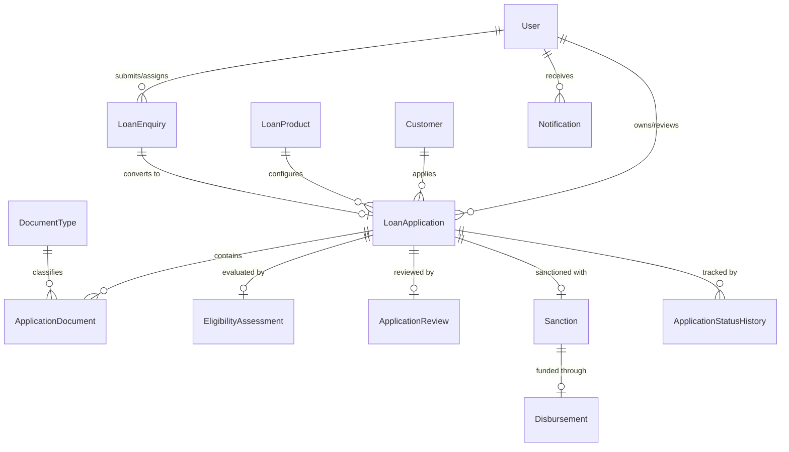

# LOANFLOW - Database Architecture & Schema Design (MongoDB Atlas / Mongoose)

This document specifies the MongoDB collections, field types, indexes, and document relationships implemented in the LOANFLOW backend.

---

## 1. Entity-Relationship Overview



---

## 2. Detailed Collection Schemas

### 2.1 `users` Collection
Stores authentication credentials and high-level role memberships.

```javascript
{
  _id: ObjectId,
  name: { type: String, required: true, trim: true },
  email: { type: String, required: true, unique: true, lowercase: true, index: true },
  password: { type: String, required: true }, // bcrypt hashed
  role: { 
    type: String, 
    required: true, 
    enum: ['CUSTOMER', 'LOAN_OFFICER', 'MANAGER', 'ADMIN'],
    default: 'CUSTOMER' 
  },
  phone: { type: String, trim: true },
  isActive: { type: Boolean, default: true },
  createdAt: ISODate,
  updatedAt: ISODate
}
```

### 2.2 `customers` Collection
Holds rich personal, demographic, and financial profile data for applicants.

```javascript
{
  _id: ObjectId,
  userId: { type: ObjectId, ref: 'User', required: true, unique: true, index: true },
  fullName: { type: String, required: true },
  dateOfBirth: { type: Date, required: true },
  gender: { type: String, enum: ['MALE', 'FEMALE', 'OTHER'], required: true },
  email: { type: String, required: true },
  phone: { type: String, required: true },
  address: {
    street: String,
    city: String,
    state: String,
    postalCode: String,
    country: { type: String, default: 'India' }
  },
  panNumber: { type: String, required: true, uppercase: true, index: true },
  idProofNumber: { type: String, required: true }, // Aadhaar / Voter / Passport
  employment: {
    employmentType: { type: String, enum: ['SALARIED', 'SELF_EMPLOYED', 'BUSINESS', 'STUDENT'], required: true },
    employerName: { type: String, required: true },
    monthlyIncome: { type: Number, required: true, min: 0 },
    existingEmiObligations: { type: Number, default: 0, min: 0 },
    experienceYears: { type: Number, default: 0 }
  },
  createdAt: ISODate,
  updatedAt: ISODate
}
```

### 2.3 `loanproducts` Collection
Maintains loan product parameters, boundaries, and interest structures.

```javascript
{
  _id: ObjectId,
  code: { type: String, required: true, unique: true, uppercase: true }, // e.g., 'PL-001'
  name: { type: String, required: true, trim: true },
  description: { type: String },
  category: { type: String, enum: ['PERSONAL', 'HOME', 'EDUCATION', 'VEHICLE'], required: true },
  minAmount: { type: Number, required: true, min: 1000 },
  maxAmount: { type: Number, required: true },
  minTenureMonths: { type: Number, required: true, min: 1 },
  maxTenureMonths: { type: Number, required: true },
  interestRateAnnual: { type: Number, required: true }, // in % (e.g. 11.5)
  minMonthlyIncome: { type: Number, required: true, min: 0 },
  maxDtiPercent: { type: Number, default: 50, min: 10, max: 90 }, // Configurable DTI threshold per product
  processingFeePercent: { type: Number, default: 1.0 },
  isActive: { type: Boolean, default: true },
  createdAt: ISODate,
  updatedAt: ISODate
}
```

### 2.4 `loanenquiries` Collection
Tracks leads prior to formal loan conversion.

```javascript
{
  _id: ObjectId,
  enquiryNumber: { type: String, required: true, unique: true, index: true }, // 'ENQ-2026-0001'
  fullName: { type: String, required: true },
  email: { type: String, required: true, index: true },
  mobile: { type: String, required: true },
  loanProductId: { type: ObjectId, ref: 'LoanProduct', required: true },
  requestedAmount: { type: Number, required: true },
  requestedTenureMonths: { type: Number, default: 36 },
  employmentType: { type: String, enum: ['SALARIED', 'SELF_EMPLOYED', 'BUSINESS', 'STUDENT'] },
  monthlyIncome: { type: Number, required: true },
  purpose: { type: String },
  status: { 
    type: String, 
    enum: ['NEW', 'CONTACTED', 'CONVERTED', 'CLOSED'], 
    default: 'NEW',
    index: true 
  },
  contactedBy: { type: ObjectId, ref: 'User' },
  contactNotes: String,
  convertedApplicationId: { type: ObjectId, ref: 'LoanApplication' },
  createdAt: ISODate,
  updatedAt: ISODate
}
```

### 2.5 `loanapplications` Collection
Central entity tracking the complete loan file throughout its lifecycle.

```javascript
{
  _id: ObjectId,
  applicationNumber: { type: String, required: true, unique: true, index: true }, // 'LOAN-2026-0001'
  customerId: { type: ObjectId, ref: 'Customer', required: true, index: true },
  userId: { type: ObjectId, ref: 'User', required: true, index: true },
  productId: { type: ObjectId, ref: 'LoanProduct', required: true },
  enquiryId: { type: ObjectId, ref: 'LoanEnquiry' },
  requestedAmount: { type: Number, required: true },
  requestedTenureMonths: { type: Number, required: true },
  purpose: { type: String, required: true },
  status: { 
    type: String, 
    required: true,
    enum: [
      'APPLICATION_CREATED',
      'DOCUMENT_PENDING',
      'DOCUMENT_VERIFICATION',
      'ADDITIONAL_DOCUMENTS_REQUIRED',
      'ELIGIBILITY_CHECK',
      'OFFICER_REVIEW',
      'MANAGER_APPROVAL',
      'APPROVED',
      'SANCTIONED',
      'DISBURSEMENT_PENDING',
      'DISBURSED',
      'REJECTED'
    ],
    default: 'DOCUMENT_PENDING',
    index: true
  },
  assignedOfficerId: { type: ObjectId, ref: 'User' },
  assignedManagerId: { type: ObjectId, ref: 'User' },
  rejectionReason: { type: String },
  rejectionStage: { type: String },
  createdAt: ISODate,
  updatedAt: ISODate
}
```

### 2.6 `applicationdocuments` Collection
Tracks individual document proofs uploaded per loan application.

```javascript
{
  _id: ObjectId,
  applicationId: { type: ObjectId, ref: 'LoanApplication', required: true, index: true },
  documentType: { 
    type: String, 
    required: true,
    enum: ['IDENTITY_PROOF', 'ADDRESS_PROOF', 'INCOME_PROOF', 'BANK_STATEMENT', 'EMPLOYMENT_PROOF']
  },
  title: { type: String, required: true },
  fileName: { type: String, required: true },
  originalName: { type: String, required: true },
  filePath: { type: String, required: true },
  fileSize: { type: Number, required: true },
  mimeType: { type: String, required: true },
  uploadedBy: { type: ObjectId, ref: 'User', required: true },
  uploadedAt: { type: Date, default: Date.now },
  status: { 
    type: String, 
    required: true,
    enum: ['PENDING', 'UPLOADED', 'UNDER_REVIEW', 'VERIFIED', 'REJECTED'],
    default: 'UPLOADED',
    index: true
  },
  verificationRemarks: { type: String },
  verifiedBy: { type: ObjectId, ref: 'User' },
  verifiedAt: { type: Date },
  createdAt: ISODate,
  updatedAt: ISODate
}
```

### 2.7 `eligibilityassessments` Collection
Stores quantitative underwriting calculations and rule evaluations.

```javascript
{
  _id: ObjectId,
  applicationId: { type: ObjectId, ref: 'LoanApplication', required: true, unique: true, index: true },
  monthlyIncome: { type: Number, required: true },
  existingMonthlyObligations: { type: Number, required: true },
  requestedAmount: { type: Number, required: true },
  tenureMonths: { type: Number, required: true },
  interestRateAnnual: { type: Number, required: true },
  estimatedEmi: { type: Number, required: true },
  totalMonthlyObligations: { type: Number, required: true },
  debtToIncomeRatio: { type: Number, required: true }, // in % (e.g. 35.4)
  result: { type: String, enum: ['ELIGIBLE', 'NOT_ELIGIBLE'], required: true },
  ruleResults: [{
    rule: String,
    passed: Boolean,
    details: Object
  }],
  notes: String,
  assessedBy: { type: ObjectId, ref: 'User', required: true },
  assessedAt: { type: Date, default: Date.now }
}
```

### 2.8 `applicationreviews` Collection
Loan Officer credit assessment notes and formal recommendation.

```javascript
{
  _id: ObjectId,
  applicationId: { type: ObjectId, ref: 'LoanApplication', required: true, index: true },
  officerId: { type: ObjectId, ref: 'User', required: true },
  recommendation: { 
    type: String, 
    required: true, 
    enum: ['RECOMMEND_APPROVAL', 'RECOMMEND_REJECTION', 'REQUEST_DOCUMENTS'] 
  },
  creditRemarks: { type: String, required: true },
  riskScore: { type: Number, min: 300, max: 900, default: 750 },
  reviewedAt: { type: Date, default: Date.now }
}
```

### 2.9 `sanctions` Collection
Formal sanction decree issued upon credit approval.

```javascript
{
  _id: ObjectId,
  sanctionNumber: { type: String, required: true, unique: true, index: true }, // 'SANC-2026-0001'
  applicationId: { type: ObjectId, ref: 'LoanApplication', required: true, unique: true, index: true },
  customerId: { type: ObjectId, ref: 'Customer', required: true },
  approvedAmount: { type: Number, required: true },
  approvedTenureMonths: { type: Number, required: true },
  interestRateAnnual: { type: Number, required: true },
  monthlyEmi: { type: Number, required: true },
  sanctionDate: { type: Date, default: Date.now },
  expiryDate: { type: Date, required: true },
  approvedBy: { type: ObjectId, ref: 'User', required: true },
  approvalRemarks: { type: String },
  termsAndConditions: [String],
  createdAt: ISODate,
  updatedAt: ISODate
}
```

### 2.10 `disbursements` Collection
Fund transfer and bank execution records.

```javascript
{
  _id: ObjectId,
  disbursementNumber: { type: String, required: true, unique: true, index: true }, // 'DISB-2026-0001'
  applicationId: { type: ObjectId, ref: 'LoanApplication', required: true, unique: true, index: true },
  sanctionId: { type: ObjectId, ref: 'Sanction', required: true },
  disbursedAmount: { type: Number, required: true },
  disbursementDate: { type: Date, default: Date.now },
  paymentMethod: { type: String, enum: ['NEFT', 'RTGS', 'IMPS', 'CHEQUE'], required: true },
  bankReferenceNumber: { type: String, required: true, unique: true },
  accountNumberMasked: { type: String, required: true },
  processedBy: { type: ObjectId, ref: 'User', required: true },
  remarks: String,
  createdAt: ISODate,
  updatedAt: ISODate
}
```

### 2.11 `applicationstatushistories` Collection
Append-only immutable audit trail.

```javascript
{
  _id: ObjectId,
  applicationId: { type: ObjectId, ref: 'LoanApplication', required: true, index: true },
  previousStatus: { type: String },
  newStatus: { type: String, required: true },
  action: { type: String, required: true }, // e.g., 'DOCUMENTS_VERIFIED', 'OFFICER_RECOMMENDED'
  performedBy: { type: ObjectId, ref: 'User', required: true },
  role: { type: String, required: true },
  remarks: { type: String },
  timestamp: { type: Date, default: Date.now, index: true }
}
```

### 2.12 `notifications` Collection
In-app user alerts.

```javascript
{
  _id: ObjectId,
  recipientId: { type: ObjectId, ref: 'User', required: true, index: true },
  applicationId: { type: ObjectId, ref: 'LoanApplication' },
  title: { type: String, required: true },
  message: { type: String, required: true },
  type: { type: String, enum: ['INFO', 'SUCCESS', 'WARNING', 'ERROR'], default: 'INFO' },
  isRead: { type: Boolean, default: false, index: true },
  createdAt: { type: Date, default: Date.now }
}
```
